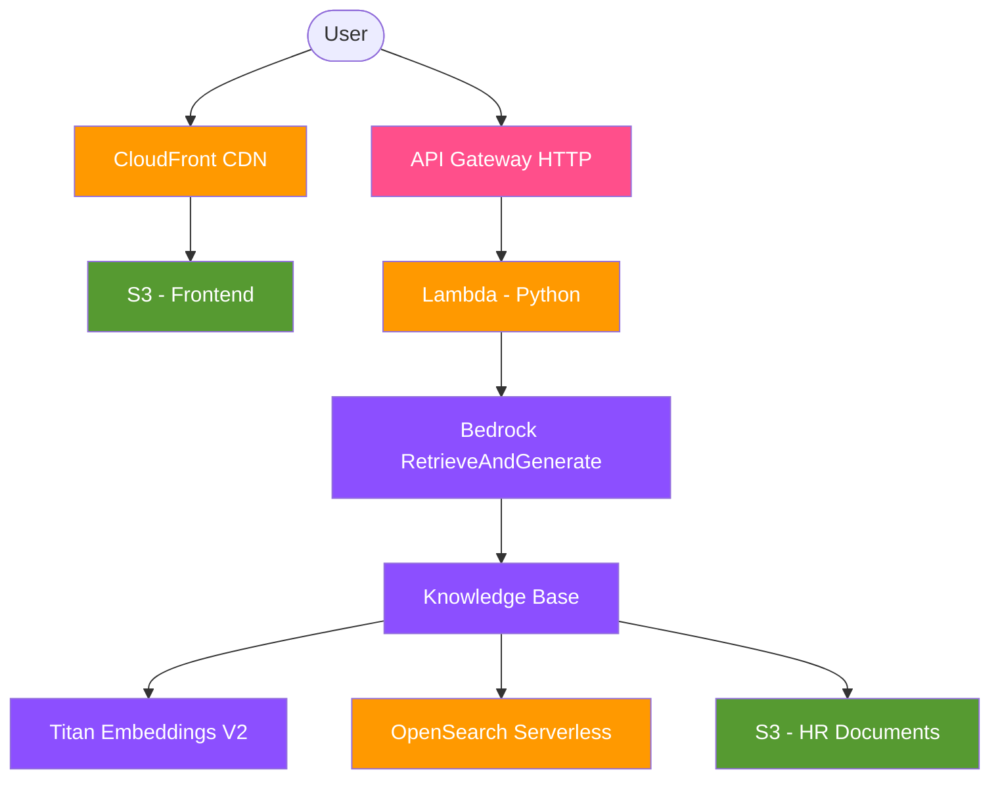

# HR Knowledge Hub

An intelligent knowledge assistant for employees and HR teams, powered by **Amazon Bedrock** and **RAG (Retrieval-Augmented Generation)**. Ask questions about company policies, benefits, leave, and onboarding in natural language and get accurate, sourced answers instantly.

## Architecture



### Data Flow

1. HR policy documents are stored in **S3** and ingested into the **Bedrock Knowledge Base**
2. Documents are chunked, embedded using **Amazon Titan Embeddings V2**, and stored in **OpenSearch Serverless**
3. Users ask questions through a **CloudFront**-hosted chat UI
4. Questions are sent to **API Gateway** → **Lambda**, which calls Bedrock's **RetrieveAndGenerate** API
5. Bedrock retrieves relevant document chunks, passes them to **Claude 3 Haiku** for answer generation
6. The answer with source citations is returned to the user

## Tech Stack

| Layer | Technology |
|-------|-----------|
| **IaC** | Terraform (~>5.0) |
| **Embedding** | Amazon Titan Embeddings V2 |
| **LLM** | Anthropic Claude 3 Haiku (via Bedrock) |
| **Vector Store** | OpenSearch Serverless (VECTORSEARCH) |
| **Knowledge Base** | Amazon Bedrock Knowledge Bases |
| **Backend** | AWS Lambda (Python 3.12) |
| **API** | Amazon API Gateway (HTTP API) |
| **Frontend** | Vanilla HTML/CSS/JS |
| **CDN** | Amazon CloudFront with OAC |
| **State** | S3 + DynamoDB (Terraform backend) |

## Features

- **Natural language Q&A** over HR policy documents
- **Multi-turn conversations** with session context
- **Source citations** showing which documents informed each answer
- **Fully serverless** architecture — no servers to manage
- **Infrastructure as Code** — entire stack deployed with a single `terraform apply`
- **Least-privilege IAM** — scoped policies for every service-to-service interaction
- **Responsive chat UI** with suggested questions and loading animations

## Project Structure

```
hr-knowledge-hub/
├── terraform/
│   ├── backend/              # Bootstrap: S3 + DynamoDB for TF state
│   ├── scripts/              # OpenSearch index creation helper
│   ├── main.tf               # Data sources and locals
│   ├── providers.tf          # AWS provider config
│   ├── variables.tf          # Input variables
│   ├── outputs.tf            # Stack outputs
│   ├── backend.tf            # S3 backend config
│   ├── s3.tf                 # HR documents bucket
│   ├── opensearch.tf         # OpenSearch Serverless collection
│   ├── bedrock.tf            # Knowledge Base + Data Source
│   ├── lambda.tf             # Lambda function
│   ├── api_gateway.tf        # HTTP API
│   ├── frontend.tf           # CloudFront + S3 static site
│   └── iam.tf                # All IAM roles and policies
├── lambda/
│   └── index.py              # Query handler
├── frontend/
│   ├── index.html            # Chat UI
│   ├── style.css             # Styles
│   └── app.js                # Client logic
├── documents/                # Sample HR policy documents
└── README.md
```

## Prerequisites

- **AWS Account** with appropriate permissions
- **Terraform** >= 1.5
- **Python 3** with pip
- **AWS CLI** configured with credentials
- **Bedrock model access** enabled for:
  - Amazon Titan Embeddings V2 (`amazon.titan-embed-text-v2:0`)
  - Anthropic Claude 3 Haiku (`anthropic.claude-3-haiku-20240307-v1:0`)

> **Enable model access**: Go to [AWS Console → Bedrock → Model access](https://console.aws.amazon.com/bedrock/home#/modelaccess) and request access for both models.

## Quick Start

### 1. Bootstrap Terraform State

```bash
cd terraform/backend
terraform init
terraform apply
```

Note the `state_bucket_name` output and update `terraform/backend.tf` with your actual bucket name.

### 2. Install Python Dependencies

```bash
pip3 install -r terraform/scripts/requirements.txt
```

### 3. Deploy Infrastructure

```bash
cd terraform
terraform init
terraform apply
```

This takes ~15-20 minutes (OpenSearch Serverless collection creation + CloudFront distribution).

### 4. Verify

```bash
# Test the API
curl -X POST "$(terraform output -raw api_endpoint)/query" \
  -H "Content-Type: application/json" \
  -d '{"query": "How many PTO days do new employees get?"}'

# Open the frontend
open "$(terraform output -raw cloudfront_url)"
```

## How It Works — RAG Pipeline

```
┌─────────────┐     ┌──────────────────┐     ┌───────────────────┐
│  User Query  │────▶│  Bedrock KB API   │────▶│  Embed Query      │
│              │     │  RetrieveAndGen   │     │  (Titan V2)       │
└─────────────┘     └──────────────────┘     └───────┬───────────┘
                                                      │
                                               Vector Search
                                                      │
                    ┌──────────────────┐     ┌───────▼───────────┐
                    │  Generate Answer  │◀────│  Retrieve Top-K   │
                    │  (Claude Haiku)   │     │  (OpenSearch)     │
                    └────────┬─────────┘     └───────────────────┘
                             │
                    ┌────────▼─────────┐
                    │  Answer + Sources │
                    └──────────────────┘
```

1. **Chunking**: Documents are split into 300-token chunks with 20% overlap
2. **Embedding**: Each chunk is vectorized using Titan Embeddings V2 (1024 dimensions)
3. **Storage**: Vectors are indexed in OpenSearch Serverless using FAISS HNSW
4. **Retrieval**: User queries are embedded and matched against stored vectors
5. **Generation**: Retrieved chunks are passed to Claude Haiku as context for answer generation

## Cost Estimation

| Service | Monthly Cost |
|---------|-------------|
| OpenSearch Serverless (2 OCUs) | ~$350 |
| Bedrock Embeddings (Titan V2) | ~$0.02/1M tokens |
| Bedrock Generation (Claude Haiku) | ~$0.25-1.25/1M tokens |
| Lambda | < $1 (demo traffic) |
| API Gateway | < $1 (demo traffic) |
| S3 + CloudFront | < $1 |
| **Total** | **~$350-355/month** |

> **Cost is dominated by OpenSearch Serverless** (minimum 2 OCUs at $0.24/hr). Remember to run `terraform destroy` when not actively demoing.

## Cleanup

Destroy all resources to stop incurring charges:

```bash
cd terraform
terraform destroy

cd backend
terraform destroy
```

## Future Enhancements

- Custom domain with ACM certificate
- Authentication with Cognito
- Streaming responses for real-time answer generation
- Document upload UI for adding new policies
- Analytics dashboard for common employee questions
- Slack integration for in-channel HR queries
